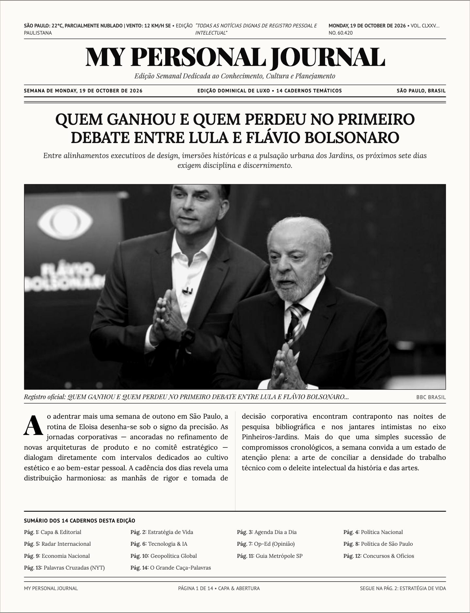
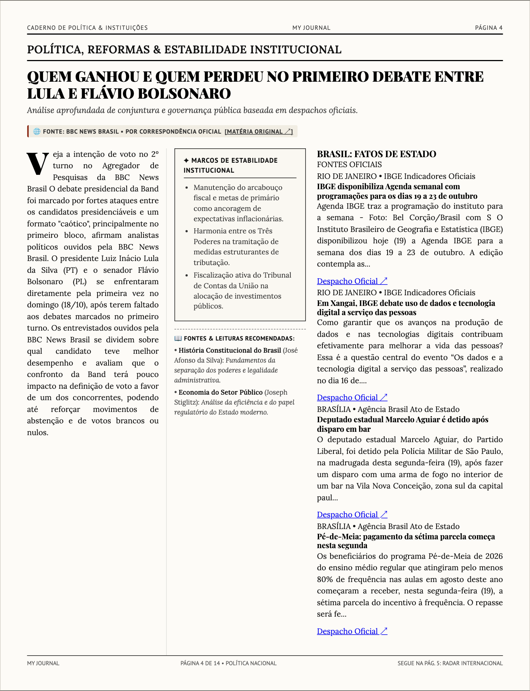
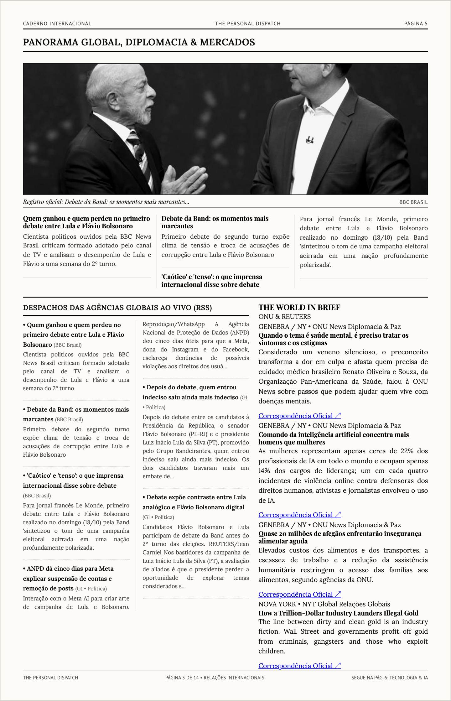
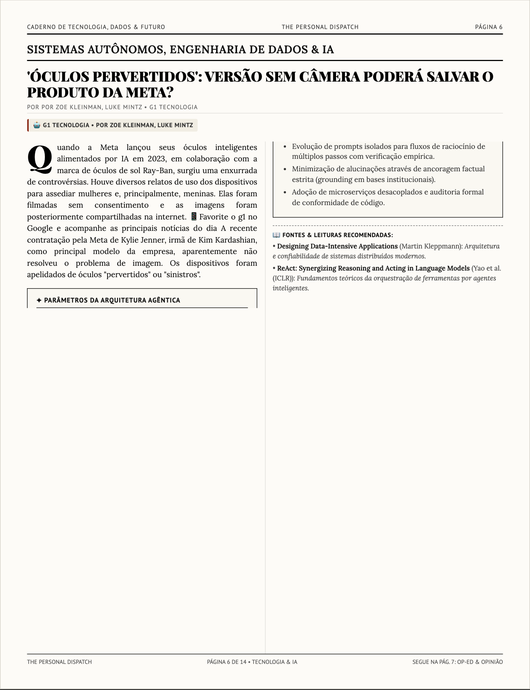
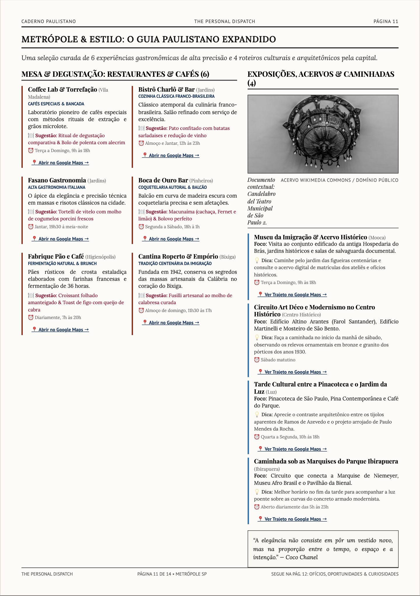
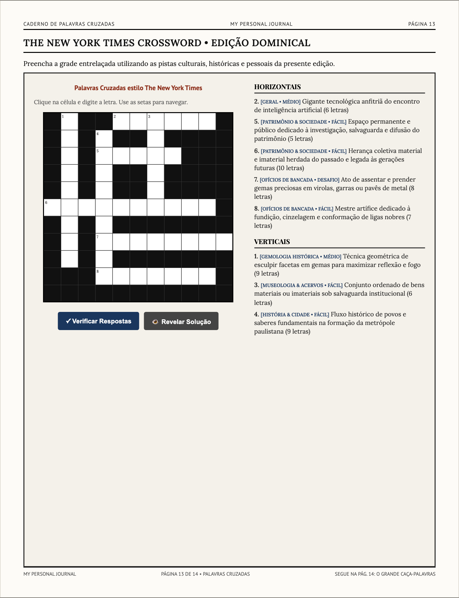
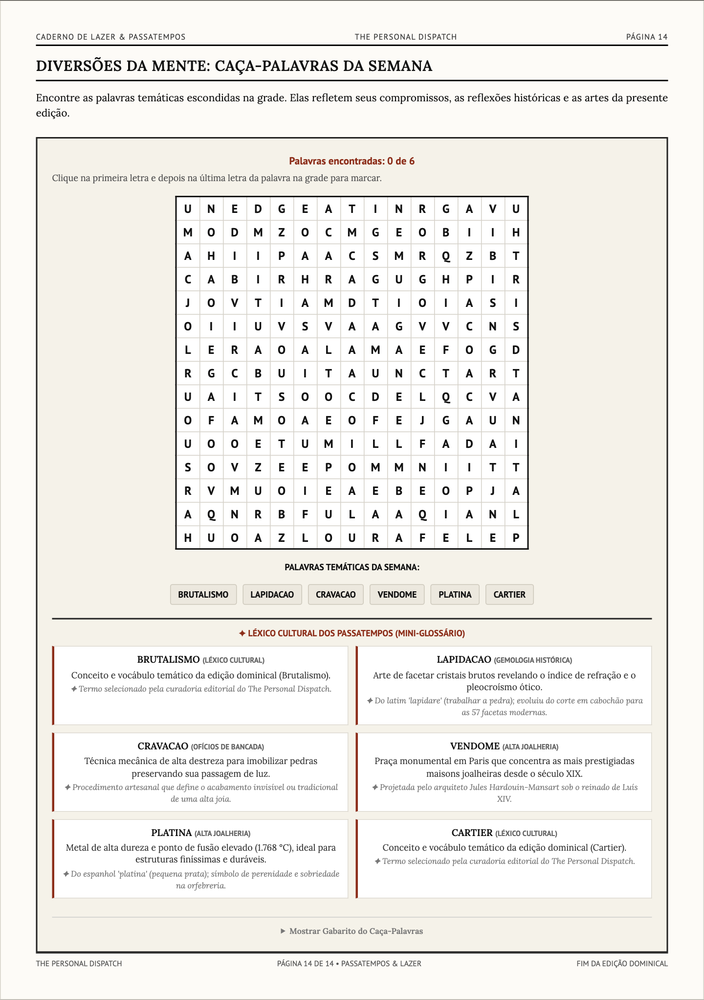
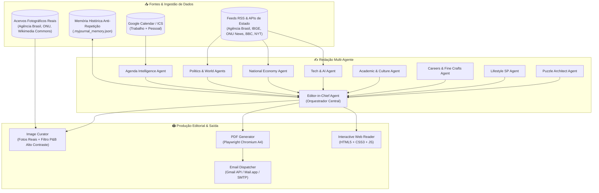
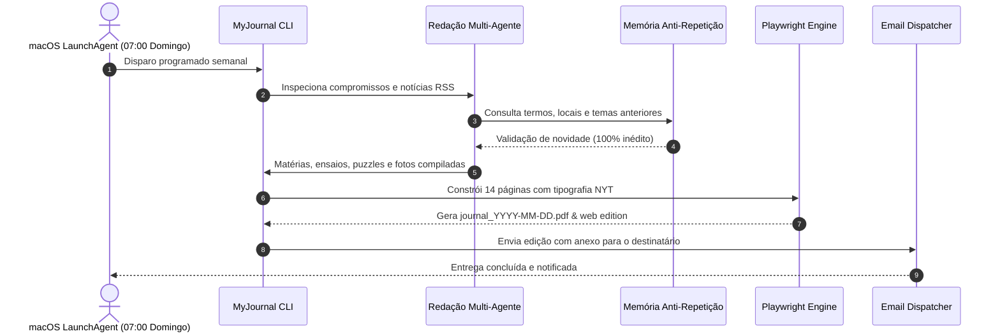

<p align="center">
  
</p>

# 📰 MyJournal AI — The Personal Dispatch

> **Seu jornal impresso semanal com design editorial do *The New York Times*, inteligência multi-agente e sincronização profunda com a sua vida.**

[](https://www.python.org/downloads/)
[](https://playwright.dev/)
[](https://ai.google.dev/)
[](LICENSE)

O **MyJournal AI** transforma sua rotina semanal em um diário impresso de alta densidade intelectual e estética editorial clássica. Ele lê seus calendários (pessoal e profissional), analisa o equilíbrio da sua rotina, monitora notícias geopolíticas ao vivo via RSS, redige ensaios culturais atemporais e compila uma edição completa de **14 páginas** pronta para impressão em PDF e leitura interativa na web.

---

## 🖼️ Galeria Editorial & Amostras Visuais

Abaixo estão capturas reais geradas pelo motor gráfico e pela redação de IA:

### 1. Capa & Matéria Principal (Page 1)
O jornal abre com um diagnóstico de ritmo da semana integrado aos seus compromissos, fotografia tratada em alto contraste P&B e manchetes globais.

<p align="center">
  
</p>

---

### 2. Brasil: Fatos de Estado & Atos Republicanos (Page 4)
Micro-cápsulas informativas baseadas estritamente em fontes oficiais de Estado (**Agência Brasil / EBC** e indicadores econômicos e demográficos do **IBGE**), com datelines em versalete no estilo clássico do NYT.

<p align="center">
  
</p>

---

### 3. The World in Brief & Relações Internacionais (Page 5)
Coluna lateral de despachos multilaterais oficiais (**ONU News em Português** e agências globais neutras), acompanhada de fotos documentais reais e monitoramento geopolítico ao vivo.

<p align="center">
  
</p>

---

### 4. Caderno de Tecnologia & Inteligência Artificial (Page 6)
Análises aprofundadas sobre computação de ponta, semicondutores, regulação de algoritmos e avanços de modelos generativos com fotos reais de laboratórios e processadores.

<p align="center">
  
</p>

---

### 5. Metrópole SP & Gastronomia (Page 11)
Roteiros paulistanos de arte, arquitetura e gastronomia com fotografia documental do patrimônio histórico e links diretos para o Google Maps.

<p align="center">
  
</p>

---

### 6. Caderno de Jogos: The NYT Crossword & Caça-Palavras (Pages 13 & 14)
Passatempos intelectuais gerados algoritmicamente a partir do vocabulário da própria edição. Na versão web, o caça-palavras e as palavras cruzadas são totalmente jogáveis em tempo real.

<table align="center">
  <tr>
    <td align="center" width="50%">
      <b>The NYT Crossword (Palavras Cruzadas)</b><br><br>
      
    </td>
    <td align="center" width="50%">
      <b>Caça-Palavras Interativo (15x15)</b><br><br>
      
    </td>
  </tr>
</table>

---

## 🏛️ Arquitetura Multi-Agente

O jornal opera como uma redação jornalística contemporânea orquestrada por agentes de IA especializados:



---

## 🔄 Fluxo de Compilação & Entrega Dominical

A automação do **MyJournal AI** é configurável via `launchd` no macOS, despertando todo domingo pela manhã:



---

## 📑 O Conteúdo das 14 Páginas

| Página | Seção Editorial | Descrição |
|:---:|:---|:---|
| **1** | **Capa (Front Page)** | Manchete principal conectada ao tom da semana, foto heroica P&B, sumário e radar internacional. |
| **2** | **Estratégia & Foco** | Análise da densidade de compromissos, blocos de concentração profunda e picos de demanda. |
| **3** | **Agenda Semanal** | Cards inteligentes de segunda a domingo organizando reuniões profissionais e momentos pessoais. |
| **4** | **Política Nacional** | Reportagem e análise dos bastidores dos poderes da República em Brasília. |
| **5** | **Mundo & Relações Internacionais** | Cobertura geopolítica global e análises estruturais de conflitos e diplomacia. |
| **6** | **Tech, IA & Inovação** | Fronteira da tecnologia, semicondutores, pesquisa de IA e transformação digital. |
| **7** | **Op-Ed: Cultura, História & Alta Joalheria** | Ensaios aprofundados sobre artes clássicas, ourivesaria histórica e alta-costura. |
| **8** | **Política & Cenário SP** | Decisões da prefeitura, câmara e governo estadual com impacto direto no cotidiano. |
| **9** | **Economia Nacional & Mercados** | Câmbio, política monetária, inflação e tendências macroeconômicas brasileiras. |
| **10** | **Geopolítica & Defesa** | Conexões multilaterais, acordos estratégicos e equilíbrios de poder global. |
| **11** | **Metrópole SP: Gastronomia & Cultura** | Curadoria gastronômica e passeios paulistanos com links do Google Maps. |
| **12** | **Concursos, Carreiras & Ofícios** | Carreiras públicas, ateliês artesanais, restauro e oportunidades acadêmicas. |
| **13** | **The NYT Crossword** | Palavras cruzadas entrelaçadas criadas a partir dos tópicos da própria edição. |
| **14** | **Caça-Palavras Interativo** | Grade 15x15 algorítmica com vocabulário inédito rastreado pela memória. |

---

## 🚀 Como Começar

### 1. Pré-requisitos
- **Python 3.10** ou superior
- **macOS** ou **Linux**
- **Navegador Chromium** (instalado automaticamente via Playwright)

### 2. Instalação

```bash
# Clone o repositório
git clone https://github.com/Helfstein-one/myjournal-ai.git
cd myjournal-ai

# Crie e ative o ambiente virtual
python3 -m venv .venv
source .venv/bin/activate

# Instale as dependências e o navegador do Playwright
pip install -r requirements.txt
playwright install chromium
```

### 3. Configuração de Variáveis de Ambiente (`.env`)

Crie seu arquivo de configuração a partir do modelo:
```bash
cp .env.example .env
```

Edite o `.env` com suas preferências e chaves de API:
```ini
# Provedores de IA (pelo menos um é recomendado)
GEMINI_API_KEY="sua_chave_gemini_aqui"
OPENAI_API_KEY="sua_chave_openai_aqui"

# Personalização
OWNER_NAME="Mauricio"
JOURNAL_TITLE="THE PERSONAL DISPATCH"

# Calendários (URLs .ics públicas ou secretas)
CALENDAR_URL_PESSOAL="https://calendar.google.com/calendar/ical/seu_pessoal/basic.ics"
CALENDAR_URL_TRABALHO="https://calendar.google.com/calendar/ical/seu_trabalho/basic.ics"

# Despacho por E-mail (Opcional)
SMTP_HOST="smtp.gmail.com"
SMTP_PORT=587
SMTP_USER="seu_email@gmail.com"
SMTP_PASSWORD="sua_senha_de_aplicativo"
```

---

## 🏃‍♂️ Como Executar

### Modo Demonstração (Zero Configuração)
Para testar a formatação, os agentes e abrir imediatamente o PDF e a versão web sem precisar de credenciais de calendário:

```bash
source .venv/bin/activate
python -m myjournal.cli --mock
```

### Modo Produção Completo
Coleta compromissos reais do Google Calendar / ICS e notícias ao vivo via RSS:

```bash
source .venv/bin/activate
python -m myjournal.cli
```

### Principais Opções de Linha de Comando (CLI)

```bash
# Escolha explícita do provedor de IA
python -m myjournal.cli --provider gemini
python -m myjournal.cli --provider openai

# Definir caminho do PDF gerado
python -m myjournal.cli --output output/minha_edicao.pdf

# Enviar automaticamente para um e-mail específico
python -m myjournal.cli --email destinatario@exemplo.com

# Personalizar nome do proprietário na hora
python -m myjournal.cli --owner "Nome Sobrenome"

# Não abrir os arquivos automaticamente após compilar
python -m myjournal.cli --no-open
```

---

## ⏰ Automação Dominical no macOS

Você pode configurar o MyJournal AI para rodar de forma 100% autônoma no seu Mac todo domingo às 07:00 da manhã e enviar a edição diagramada para o seu e-mail:

```bash
# Instala o serviço LaunchAgent no macOS
python -m myjournal.cli --install-schedule --email seu_email@gmail.com

# Para remover a automação caso deseje
python -m myjournal.cli --uninstall-schedule
```

---

## 📂 Estrutura do Repositório

```
myjournal-ai/
├── assets/
│   └── images/               # Previews das páginas e ilustrações da documentação
├── myjournal/
│   ├── agents/               # Especialistas da Redação Multi-Agente
│   │   ├── editor_in_chief.py        # Orquestrador editorial e curador
│   │   ├── agenda_agent.py           # Análise cognitiva de rotina e estresse
│   │   ├── politics_world_agent.py   # Cobertura política e geopolítica
│   │   ├── national_economy_agent.py # Análises econômicas e de mercado
│   │   ├── tech_ai_agent.py          # Cobertura de tecnologia e IA
│   │   ├── culture_agent.py          # Ensaios de artes, moda e alta joalheria
│   │   ├── careers_crafts_agent.py   # Ofícios clássicos e concursos
│   │   ├── lifestyle_sp_agent.py     # Gastronomia e passeios em SP
│   │   └── puzzle_agent.py           # Algoritmos do NYT Crossword e Caça-Palavras
│   ├── automation/
│   │   └── scheduler.py              # Agendador nativo macOS (launchd)
│   ├── calendar/
│   │   ├── client.py                 # Conexão Google Calendar OAuth2 & ICS
│   │   └── mock_calendar.py          # Dados simulados para modo demo
│   ├── content/
│   │   ├── news_fetcher.py           # Ingestão de feeds RSS ao vivo
│   │   ├── image_curator.py          # Processamento fotográfico P&B
│   │   └── mock_content.py           # Textos base de fallback
│   ├── delivery/
│   │   └── mailer.py                 # Despacho multi-canal (Gmail/Mail.app/SMTP)
│   ├── games/
│   │   ├── crossword.py              # Algoritmo gerador de Palavras Cruzadas
│   │   └── word_search.py            # Algoritmo de montagem de Caça-Palavras
│   ├── renderer/
│   │   ├── pdf_generator.py          # Compilador Playwright de PDF A4
│   │   ├── interactive_web.py        # Renderizador da versão Web Interativa
│   │   ├── style.css                 # Folha de estilo editorial The New York Times
│   │   └── templates/
│   │       ├── newspaper.html        # Diagramação do jornal impresso (14 páginas)
│   │       └── interactive_journal.html # Interface web interativa
│   ├── cli.py                        # Ponto de entrada CLI principal
│   └── config.py                     # Gerenciamento de caminhos e ambiente
├── .env.example                      # Modelo de variáveis de ambiente
├── .gitignore                        # Proteção de credenciais e caches
├── CHANGELOG.md                      # Histórico detalhado de versões
├── requirements.txt                  # Dependências do projeto
└── README.md                         # Documentação oficial
```

---

## 📜 Licença

Distribuído sob a licença **MIT**. Consulte o arquivo `LICENSE` para mais detalhes.
